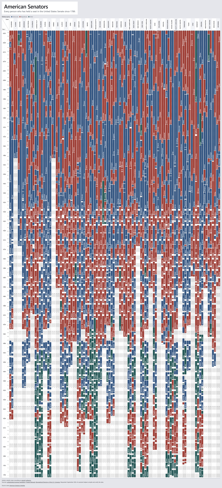
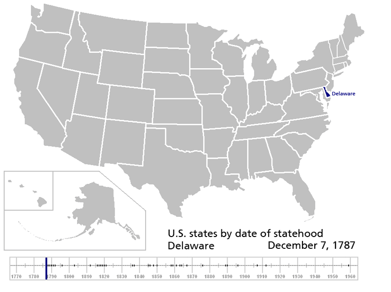

# American Senators Timeline

[](https://witold1.github.io/american-senators-timeline/)<br>


<br>

<br>


Interactive timeline of United States Senators (federal senators) from the 1st United States Congress (1789) to the present day. See the tenure of senators from confirmation date (*with many legal details) to departure. Inspired by [The Supreme Court has had 116 justices. Here's who put them there](https://usafacts.org/articles/the-viz-lab/supreme-court-tenure/) by USAFacts.

## Description

<p align="center">
  
</p>

### 1. Layers

| Element | Meaning |
|---------|---------|
| Colored bars | Senators on that seat (color by party) |

Hover bars for names, party, dates, and time served. Click a bar to open its details and copy the name.

### 2. Controls

The chart bar holds search, sorting, color, orientation, Save image (SVG or PNG), and the settings gear. Theme sits above the title.

Settings panel:

- **Show term bars** / **Show senator names** / **Last names only** / **Name colors match bars**
- **Show admission year** / **Show region filter** / **Show Congress numbers** / **Color historic parties**
- **Palette**: Muted / Vivid

Each toggle has a tooltip describing what it changes.

## Data

<p align="center">
  
</p>

A Congress is a two-year period, while a senator's normal term lasts six years, so one Senate term can span several Congresses. Each state has two Senate seats, and each seat belongs to one of three classes (Class 1, Class 2, or Class 3). The class determines the seat's place in the Senate's staggered six-year election cycle; it does not describe the senator personally. When one senator replaces another, they normally continue to occupy the same seat and class. A senator does not leave office when a Congress ends; for example, James Mason remained a senator across several Congresses until he left the Senate in 1861. Congress itself can also have several sessions, with recesses between them, but those recesses do not interrupt a senator's service. The confusing part is that being elected does not always mean immediately serving: someone elected for a future term can be called a senator-elect until the new term begins. Likewise, someone appointed to a vacancy can begin serving before the next regular election. If a senator leaves early, the seat becomes vacant, and another person may be appointed to fill the vacancy and later elected to fill the unexpired term. Nathan Farwell is an example: he was appointed after William P. Fessenden resigned, then elected by the Maine legislature to continue the same unexpired term. He therefore had two periods with different legal bases—appointed and elected—but did not serve two separate Senate terms.

There are several other reasons a historical senator's timeline can have gaps or unusual transitions. A state may not yet have been admitted to the Union, a Senate seat may remain vacant because an election was delayed or a legislature failed to elect someone, or an election may be contested, meaning the apparent winner is not immediately seated. A senator-designate generally refers to someone appointed or selected but not yet fully qualified or seated. On the other hand, recesses, adjournments, and the end of a Congress do not create gaps in a senator's service. Before the 20th Amendment, this was particularly confusing because a new Congress formally began on March 4, while its regular session often did not begin until much later. Thus, when reading a historical Senate timeline, it is useful to distinguish states, Senate seats and classes, Congresses and sessions, Senate terms, actual service dates, elections, appointments, vacancies, and seating rather than treating every Congress boundary as a change of senator.

Dataset layers under `data/`:

- `catalog.json` - available datasets and default id
- `american-senators/` - Senate chart pack (`raw/`, `auxiliary/`, `processed/`)
- `post-soviet-kingdoms/` - country files from rulers-of-post-soviet-kingdoms (`countries/`, auto-lanes)
- `examples/five-countries.json` - short sample opened from the upload dialog

Switch datasets with `#american-senators` / `#soviet-states` (or the top-bar selector). Schema notes: [`data/README.md`](data/README.md) and [`data/american-senators/README.md`](data/american-senators/README.md).

Seat JSON is generated from [unitedstates/congress-legislators](https://github.com/unitedstates/congress-legislators). Overlapping spans are checked against the [Senate Manual, 104th Congress](https://www.govinfo.gov/content/pkg/SMAN-104/html/SMAN-104-pg961.htm):

```powershell
pip install -r scripts/requirements.txt
python scripts/import_senators.py
```

## Run locally

Preferred: run a local server, then open the URL it prints. The page loads `data/catalog.json`, then that dataset’s `auxiliary/meta.json`. Senate seats come from `processed/seats-all.json`. Post-Soviet countries come from one JSON file each.

```powershell
.\serve.ps1
```

Or: `python -m http.server 8080`

Opening `index.html` via `file://` will not load data (browsers block local `fetch`). Use the server above or host on GitHub Pages.

## Repository layout

```text
index.html         Page shell
serve.ps1          Local static server (Windows)
scripts/
  import_senators.py       YAML + Senate Manual → seats-all.json; keeps the meta view block
  resolve_overlaps.py      Clips overlapping spans in seats-all.json
css/
  themes.css           Tokens, light/dark, palette presets
  layout.css           Reset, header, settings, footer, responsive
  chrome.css           Filters, chips, export, legend
  upload.css           Upload dialog
  chart.css            Axis, state groups, bars (vertical)
  chart-horizontal.css Horizontal orientation overrides
  overlay.css          Tooltip + debug panel
js/
  app.js                   Starts the page: scrolling, the upload button, and the first draw
  load.js                  Loads the catalog and the dataset for the current link
  chart/                   Draws the timeline
    geometry.js            Where a date sits, and how wide or tall each year is
    lanes.js               Overlapping people: shared row or a second lane
    palette.js             Colors for parties and for individual people
    labels.js              How a name is shortened and drawn on a bar
    axis.js                Year scale and Congress bands
    bars.js                Colored term shapes
    rows.js                One row per state or country, plus date marks
    render.js              Puts the scale and the rows together
    interaction.js         Click a bar to open the detail drawer and copy the name
    dom.js                 Shared handles used by the other chart scripts
  page-shell/              Page around the chart: chips, gear, theme, export, and debug
    filters.js             Search, sort, region, and color; shows or hides rows
    filter-controls.js     Chips along the top
    view-chrome.js         Rebuilds those chips from the dataset that is open
    controls.js            Gear panel
    theme.js               Light, dark, or match the system
    export.js              Save a PNG or an SVG
    debug.js               Environment details for bug reports
  data-selectors/          Custom data selectors, loaded the first time the dialog opens
    index.js               Entry
    dialog.js              Open, file choice, and presets
    map.js                 Column-mapping table
    chrome.js              Display settings in the dialog
    apply.js               Build seats and swap the chart
    records.js             Read the JSON, dates, and people lists
    state.js               Shared session
    cells.js               Checkboxes and radios
data/
  catalog.json             Dataset registry
  american-senators/       Senate raw / auxiliary / processed
  post-soviet-kingdoms/    Country files (overlapping terms share a row or take a second lane)
  examples/
    five-countries.json    Short sample opened from the upload dialog
```

## License & credit

| Part | License |
|------|---------|
| Website code (HTML, CSS, JS, scripts) | [MIT](LICENSE) |
| Dataset under `data/` | [CC BY-SA 4.0](LICENSE-DATA) |

Legislator terms, parties, and identifiers come from [unitedstates/congress-legislators](https://github.com/unitedstates/congress-legislators) (public domain / CC0 community data). Overlapping spans were checked against the [Senate Manual, 104th Congress](https://www.govinfo.gov/content/pkg/SMAN-104/html/SMAN-104-pg961.htm).

_Made with AI. Curated by Human._
